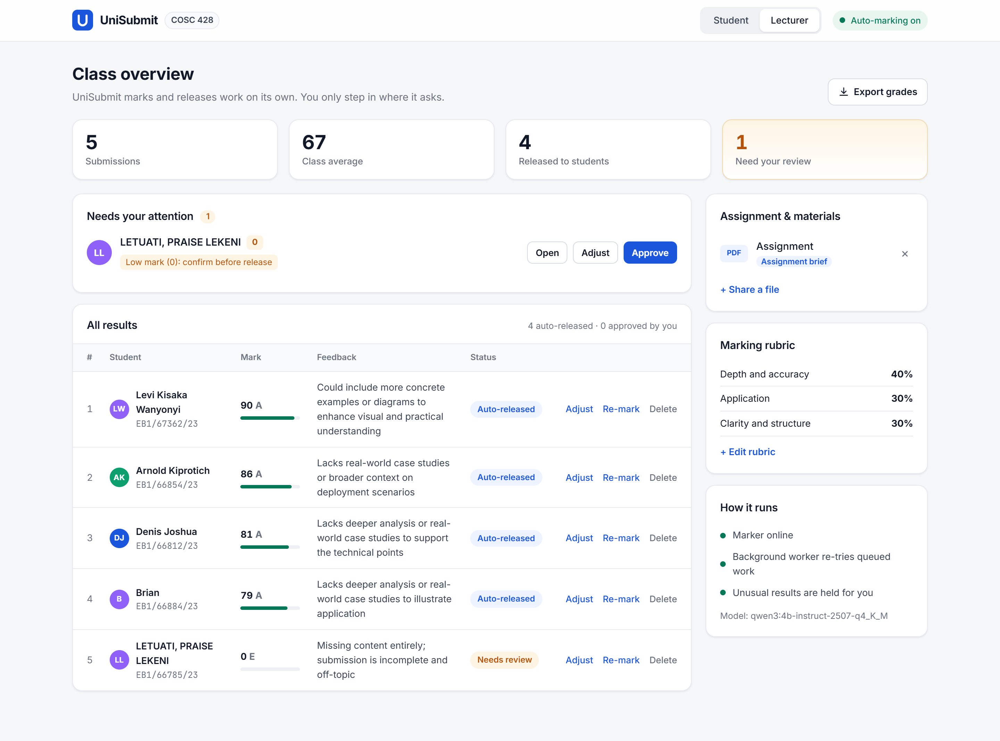
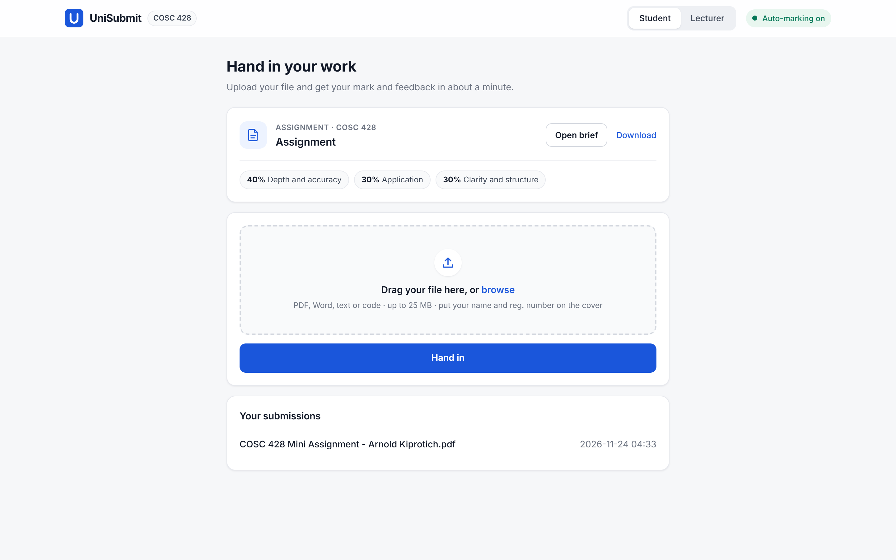
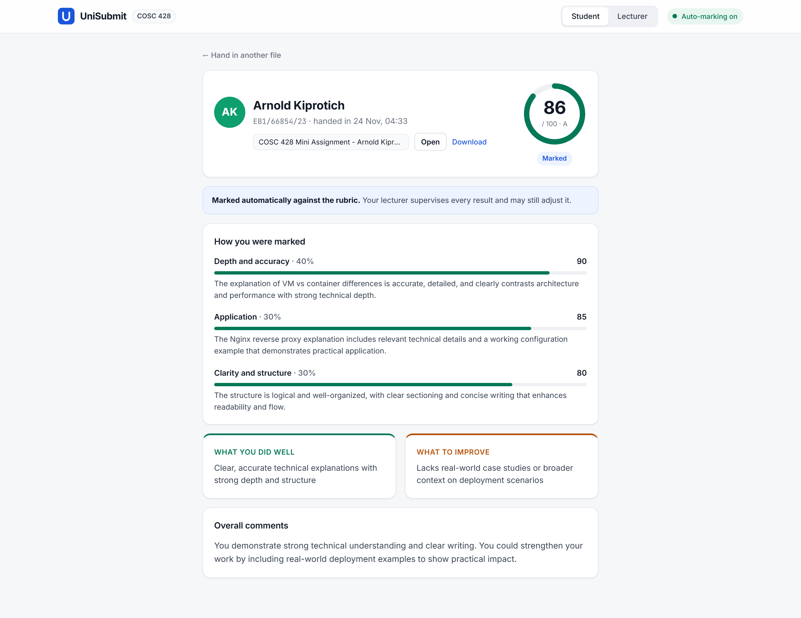
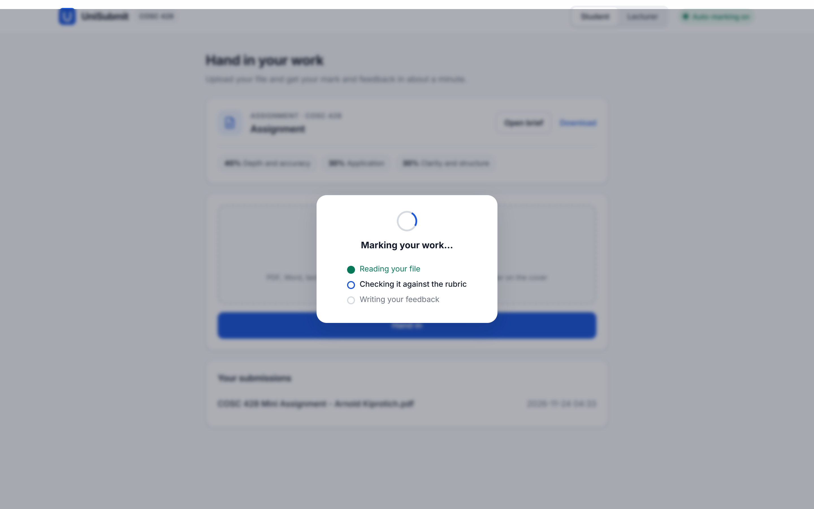
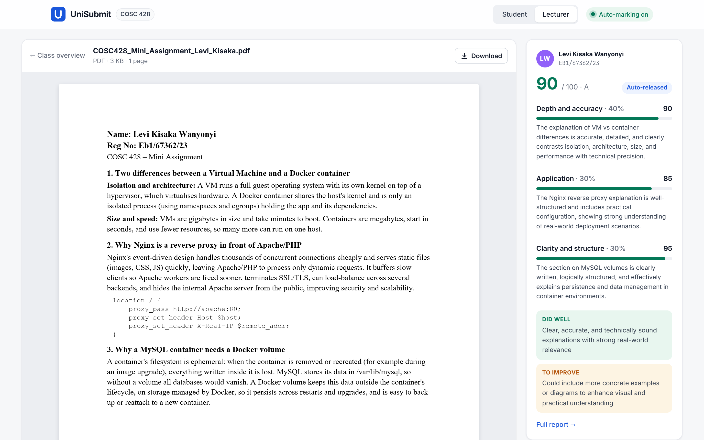
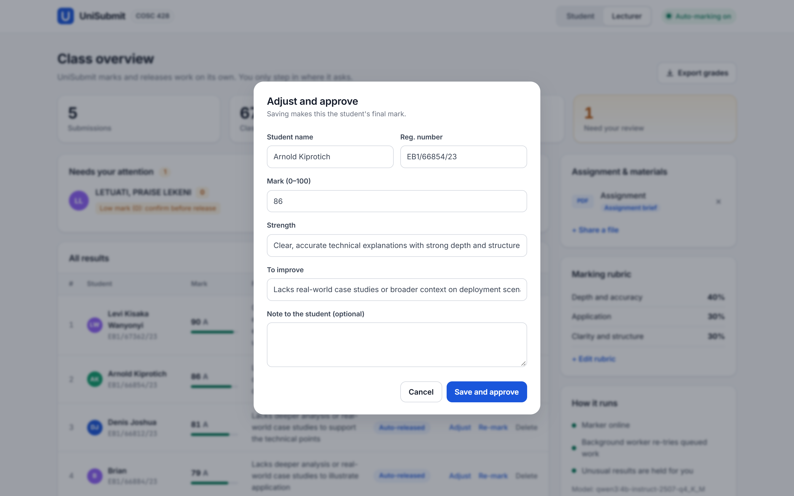
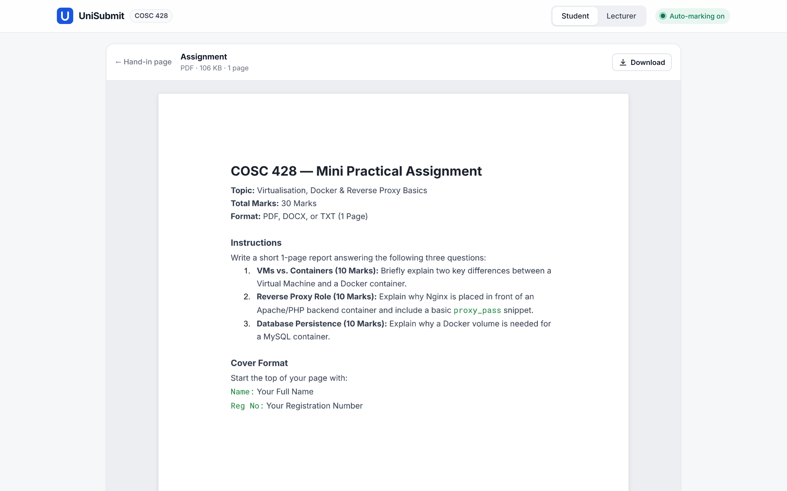
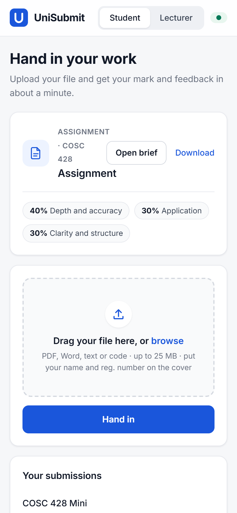
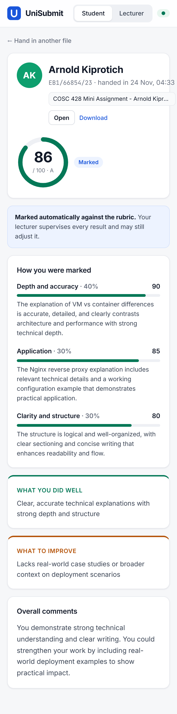
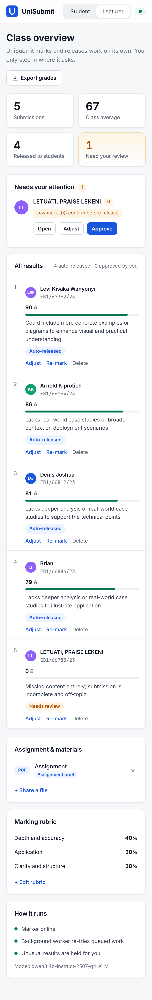

# UniSubmit Lite

**Coursework that marks itself, with the lecturer as supervisor.** Students hand in a file and get a mark,
a per-criterion breakdown and written feedback in under a minute. A local AI model marks every submission
against the lecturer's rubric and assignment brief, releases normal results straight away, and holds anything
unusual for the lecturer to check.

Built for the **COSC 428 group practical** (virtualisation, containerisation and web deployment): an Ubuntu VM
running Docker, with Nginx in front of Apache/PHP and MySQL.



## What it does

| For students | For the lecturer |
| --- | --- |
| Read the assignment brief and rubric in the browser | Share the brief and course files; the marker reads the brief too |
| Hand in a PDF, Word, text or code file by drag-and-drop | Watch results arrive: marked, ranked and released automatically |
| Get a mark, grade, per-criterion marks with comments, strengths, gaps | Clear a short **Needs your attention** queue instead of marking everything |
| Read their own work in the built-in viewer, or download it | Open any document beside its marks; adjust and approve in one dialog |
| Group work recognised: every member listed, duplicate reg. numbers flagged | Export the whole class as a CSV gradebook |

### The supervisor model

| Status | Meaning | Student sees |
| --- | --- | --- |
| Queued | Waiting for the marker (e.g. uploaded while the AI was offline); the worker retries on its own | "Being marked" (page refreshes itself) |
| Auto-released | Marked against the rubric and released at once | Mark and feedback |
| Needs review | Marked, but held: low mark, no reg. number, duplicate group reg. numbers, very short file, or unreadable | "Your lecturer is checking this" |
| Approved | Confirmed or adjusted by the lecturer | Final mark and the lecturer's note |

## Screenshots

| Hand in | Result | Marking in progress |
| --- | --- | --- |
|  |  |  |

| Document beside its marks | Adjust and approve | Assignment brief |
| --- | --- | --- |
|  |  |  |

| Phone: hand in | Phone: result | Phone: lecturer |
| --- | --- | --- |
|  |  |  |

## Architecture

```
Browser ──HTTPS──> Tailscale Funnel (in the VM)
                       │
         ┌─────────────┴──────────── Ubuntu 24.04 VM (Multipass on Hyper-V) ─────────────┐
         │   Docker network "app-tier"                                                    │
         │   ┌──────────┐ proxy_pass ┌──────────────┐  PDO  ┌───────────┐                │
         │   │  Nginx   │──────────> │ Apache + PHP │─────> │ MySQL 8.0 │                │
         │   │  :80     │            │  (the app)   │       │ volume    │                │
         │   └──────────┘            └──────┬───────┘       └─────▲─────┘                │
         │                                  │      ┌────────────┐ │                      │
         │                                  │      │  worker    │─┘ marks queued work    │
         │                                  │      └─────┬──────┘                        │
         └──────────────────────────────────┼────────────┼───────────────────────────────┘
                                            └─────┬──────┘
                                  Ollama (qwen3:4b-instruct) on the host GPU
```

| Container | Image | Role |
| --- | --- | --- |
| `unisubmit_nginx` | `nginx:alpine` | Reverse proxy on port 80; 25 MB uploads; 180 s timeouts; blocks `/uploads/`, `lib.php`, `worker.php` |
| `unisubmit_web` | `php:8.2-apache` + `pdo_mysql`, `zip`, `poppler-utils` | The PHP app |
| `unisubmit_worker` | same image | Background marker: marks anything still queued, no clicks needed |
| `unisubmit_db` | `mysql:8.0` | Database `unisubmit_db` on the persistent `db_data` volume |

### Code

| File | What it is |
| --- | --- |
| `src/index.php` | Student page: assignment, hand-in, result report |
| `src/lecturer.php` | Lecturer dashboard: attention queue, results, materials, rubric, CSV export |
| `src/view.php` | Document viewer (pdf.js for PDF, mammoth.js for Word, escaped text for code) |
| `src/download.php` | Sends stored files as attachments only |
| `src/lib.php` | Database, schema upgrades, text extraction, AI marking, review flags, page chrome |
| `src/worker.php` | The background marker loop |
| `db_init.sql` | Schema for a fresh database |
| `start.sh` + `unisubmit.service` | Start the stack at VM boot and point it at the host's current IP |
| `deploy/start-vm.ps1` | Windows logon task: starts the VM |
| `tools/cdp-shots.mjs` | Takes the screenshots above through Edge's DevTools protocol |

## Run it

Requirements: a Linux host or VM with Docker Engine and Compose v2, and [Ollama](https://ollama.com) reachable
from it with `qwen3:4b-instruct-2507-q4_K_M` pulled (`ollama pull qwen3:4b-instruct-2507-q4_K_M`).

```bash
git clone https://github.com/Brian-Mbuya/unisubmit-lite.git ~/unisubmit && cd ~/unisubmit
mkdir -p uploads && sudo chown 33:33 uploads           # www-data in the PHP container
echo "OLLAMA_HOST=http://<ollama-host>:11434" > .env
sudo docker compose up -d --build
```

Open `http://<vm-ip>/`. Without Ollama the app still works: uploads are queued and the worker marks them once
the model is reachable.

**Start on boot** (inside the VM): `sudo cp unisubmit.service /etc/systemd/system/ && sudo systemctl enable --now unisubmit`.

**Public HTTPS link** (optional): install Tailscale in the VM, then `sudo tailscale funnel --bg 80`.

> This is a demo build: there is no login, and the database password in `docker-compose.yml` is a placeholder.
> Add authentication and real secrets before using it with a real class.

## Two-minute demo

1. **Student, 0:00.** Open the app on a phone. Show the assignment card, open the brief, hand in a report.
2. **0:30.** The marking overlay runs; about 10 s later the result page shows the mark ring, per-criterion marks and feedback.
3. **Lecturer, 1:00.** Switch to Lecturer. The new result is already ranked and released. Point at *Needs your attention*: a low mark held back automatically.
4. **1:30.** Open a document beside its marks. Adjust the mark, add a note, **Save and approve**; refresh the student's page to show *Final*.
5. **2:00.** Export grades to CSV. In a terminal, `docker ps` shows the four containers and a `SELECT` shows the same rows in MySQL.

## COSC 428 brief coverage

| Requirement | Where |
| --- | --- |
| VMs, Docker, Ubuntu, access interface | Multipass VM `cosc428-vm`, Ubuntu 24.04, Docker + Compose, `multipass shell` |
| Nginx configured | `nginx.conf` (reverse proxy, limits, timeouts, blocked paths) |
| Apache in the backend container | `Dockerfile` (`php:8.2-apache`) |
| PHP GUI with user interaction | `src/` pages |
| MySQL installed, database created, linked to PHP | `db` service, `db_init.sql`, PDO in `lib.php` |
| Environments linked | One Docker network; VM ↔ host Ollama; Funnel for public access |
| Admin files downloadable by users | Course materials on the Lecturer page, View/Download on the Student page |

## Group 5

Brian Mbuya · Nancy Wangare · Dencel Muchoki · Praise Lekeni · Charity Muigai · Lewis Njega · Jason Mageto ·
Arnold Kiprotich · Mwangi Lucy Ann · Levi Kisaka · Osborn Nyakaru · Denis Joshua
