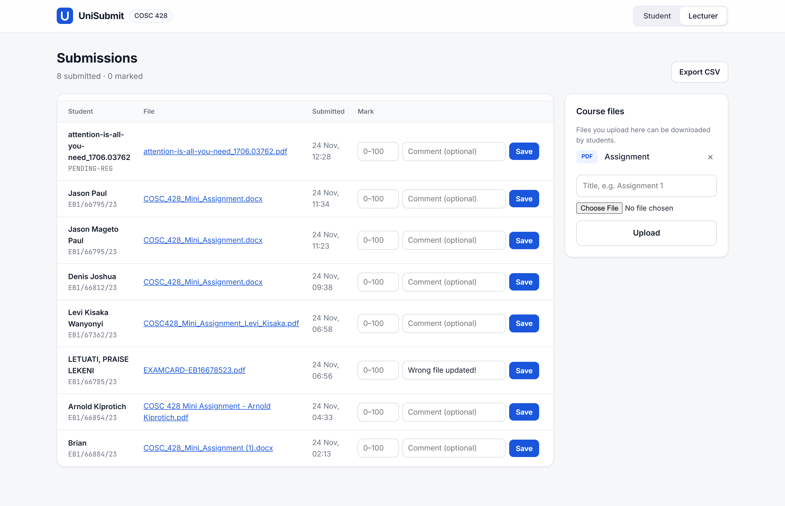
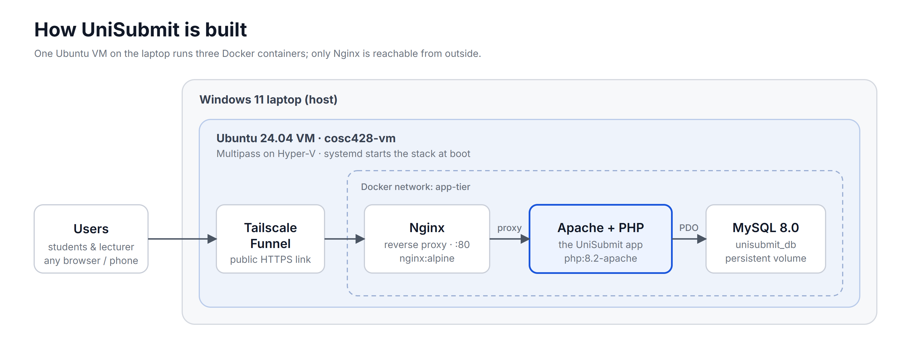
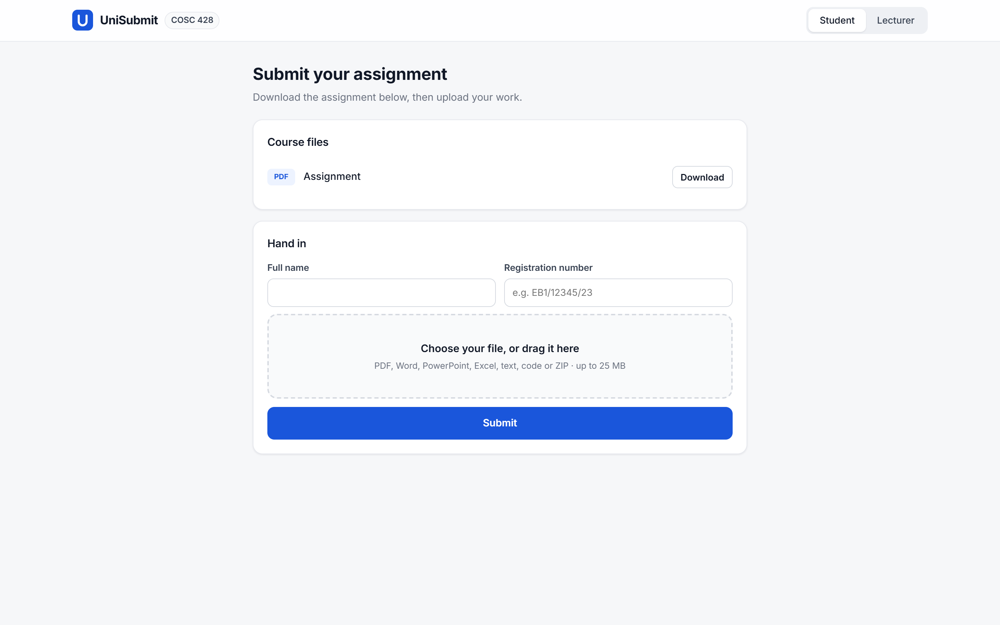
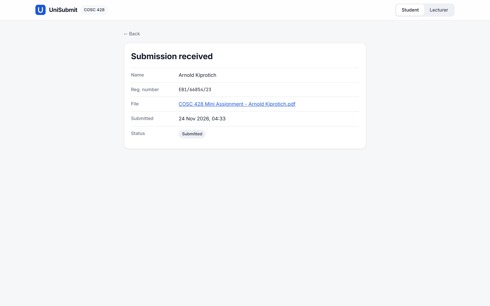
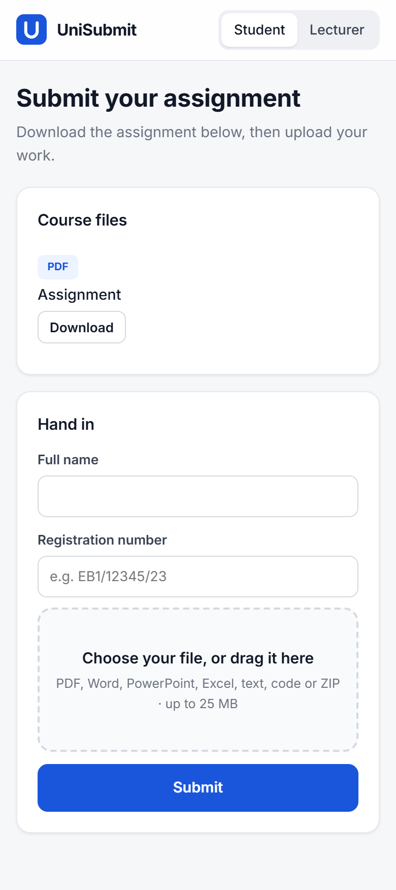

# UniSubmit

A simple university assignment submission platform, built for the **COSC 428 group practical**
(virtualisation, containerisation and web deployment). Students download course files and submit their work;
the lecturer downloads submissions, records marks and shares files.

It runs on an **Ubuntu VM** with **Docker**: **Nginx** in front, **Apache + PHP** behind it, and **MySQL** for the data.



## Features

| Students | Lecturer (admin) |
| --- | --- |
| Download files the lecturer shares | Upload and remove course files |
| Submit an assignment with name and registration number | See every submission and download the files |
| Get a receipt page with a private link | Give a mark (0–100) and a comment |
| See their mark and comment once marked | Export all submissions as CSV |

## Architecture



| Container | Image | Role |
| --- | --- | --- |
| `unisubmit_nginx` | `nginx:alpine` | Reverse proxy on port 80; the only public entry point |
| `unisubmit_web` | `php:8.2-apache` + `pdo_mysql` | The PHP application |
| `unisubmit_db` | `mysql:8.0` | Database `unisubmit_db` on a persistent volume |

| File | Purpose |
| --- | --- |
| `docker-compose.yml` | The three containers, the `app-tier` network and the `db_data` volume |
| `Dockerfile` | Apache + PHP image with the MySQL driver |
| `nginx.conf` | Reverse proxy, 25 MB upload limit, blocked internal paths |
| `db_init.sql` | Creates the `submissions` and `materials` tables |
| `src/index.php` | Student page and submission receipt |
| `src/lecturer.php` | Lecturer page: submissions, marks, course files, CSV |
| `src/download.php` | Sends stored files as downloads |
| `src/lib.php` | Database connection, upload handling, page layout |
| `start.sh`, `unisubmit.service` | Start the stack when the VM boots |

## Run it

```bash
git clone https://github.com/Brian-Mbuya/unisubmit-lite.git ~/unisubmit && cd ~/unisubmit
mkdir -p uploads && sudo chown 33:33 uploads      # www-data in the PHP container
sudo docker compose up -d --build
```

Open `http://<vm-ip>/`. Demo build: there is no login, and the database password is a placeholder.

## Screenshots

| Student page | Receipt | Phone |
| --- | --- | --- |
|  |  |  |

## Documents

- [Written report (Word)](docs/COSC428_Group5_UniSubmit_Report.docx)
- [Presentation slides (PowerPoint)](docs/COSC428_Group5_UniSubmit_Slides.pptx)

## Group 5

Brian Mbuya · Nancy Wangare · Dencel Muchoki · Praise Lekeni · Charity Muigai · Lewis Njega · Jason Mageto ·
Arnold Kiprotich · Mwangi Lucy Ann · Levi Kisaka · Osborn Nyakaru · Denis Joshua

> An earlier version with AI marking is kept on the `ai-version` branch.
